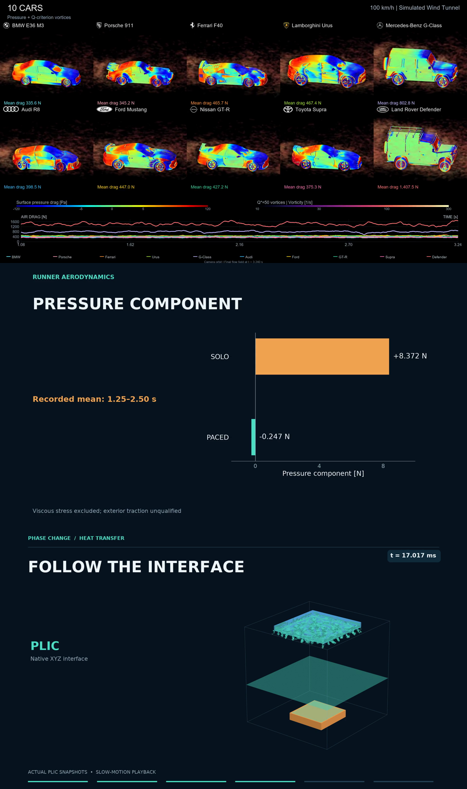

# CFD work portfolio

Vehicle aerodynamics, runner drafting, conjugate heat transfer and phase-change cooling. This collection preserves code, small setup inputs, usage notes, agent handoffs and short result media from the same project history.

[Watch the 24-second overview](media/PROJECTS_OVERVIEW.mp4)

## Explore the cases

| Project | Source and setup | Short videos |
|---|---|---|
| Vehicles | [Ten-vehicle campaign](examples/IBM_CFD-incomp-LES_CPU-OpenMP_Fortran_13-ten-vehicle-campaign), [EV pair](examples/IBM_CFD-incomp-LES_CPU-OpenMP_Fortran_11-Model3-vs-IONIQ5), [SUV pair](examples/IBM_CFD-incomp-LES_CPU-OpenMP_Fortran_12-Urus-vs-GClass), Ahmed and DrivAer | [Landscape](media/VEHICLE_CAR10_LANDSCAPE.mp4) / [Portrait](media/VEHICLE_CAR10_PORTRAIT.mp4), [DrivAer wake](media/VEHICLE_DRIVAER_WAKE.mp4), [EV](media/VEHICLE_EV_PAIR.mp4), [SUV](media/VEHICLE_SUV_PAIR.mp4) |
| Runners | [Solo vs inverted-eight formation](examples/IBM-penalty_CFD-incomp-LES_CPU-OpenMP_CPP-Python_15-solo-vs-eight-runners): penalty IBM, Vreman SGS, 21.0975 km/h, 192 spm | [Landscape summary](media/RUNNER_RECORDED_SUMMARY_LANDSCAPE.mp4) / [Portrait summary](media/RUNNER_RECORDED_SUMMARY_PORTRAIT.mp4) |
| Heat transfer and phase change | [Seven NGA2 examples](README_NGA2.md): IBM startup, shock startup, water CHT, Stefan, heated vapor, dielectric pool and true 3D immersion cooling | [3D introduction](media/IMMERSION_COOLING_LANDSCAPE_DRAFT01.mp4) / [Portrait](media/IMMERSION_COOLING_PORTRAIT_DRAFT01.mp4), [25–35 ms flow preview](media/IMMERSION_FLOW_25_TO_35MS_PREVIEW.mp4), [Thermal overview](media/EXAMPLE_OVERVIEW.mp4) |

The [full index](docs/PROJECT_COVERAGE.md) contains 21 examples and references. Earlier prototypes, preparation-only entries and stopped work are labelled by their actual status. Folder names use `METHOD_PHYSICS_RESOURCE_LANGUAGE_CASE`; CPU OpenMP, MPI and serial paths are identified without implying a GPU backend.

## Use or transfer the code

1. Read the selected case README and [model limits](docs/MODELS_AND_LIMITS.md).
2. Follow [NGA2 build/use](docs/BUILD.md) or [legacy vehicle/runner setup](docs/LEGACY_SETUP.md).
3. Run `python3 -B scripts/verify_portfolio.py` to check the bundled source hashes, links and excluded artifacts.
4. For another agent, start with [the portfolio handoff](prompts/PORTFOLIO_START_HERE.md), then [vehicles](prompts/VEHICLES.md), [runners](prompts/RUNNERS.md) or [NGA2](prompts/START_HERE.md).

Seven NGA2 and nine complete legacy build recipes passed local build checks. Nineteen legacy cold-start input variants passed setup-only checks. Archived/reference-only entries are not promoted to completed simulations. Clean installation and fresh runs on another computer remain separate checks. See [NGA2 build checks](provenance/RELEASE_CHECKS.json), [current 3D repair checks](provenance/THERMAL_ITERATION_V6_CHECKS.json) and [legacy build checks](provenance/LEGACY_BUILD_CHECKS.json).

## Interpret the results

The original runner flow videos and fields were deleted at an earlier user-requested closeout. The new runner clips summarize retained formation coordinates and recorded pressure-component means; they are not recovered flow footage. The pressure-only comparison is not qualified total drag or a race-performance prediction.

The narrated 3D introduction uses the completed historical 20 ms run. The separate flow preview uses five actual saved states from 25.0178 to 35.0178 ms, with PLIC, temperature and velocity at matching times. Exported temperature, latent source, VOF and velocity were checked against all eight physical CSV packets at one matched time. The longer v4 continuation stopped at 37.0178 ms. Its depleted-phase moment failure was located and v5 crossed it to37.2ms at unchanged25us. Currentv6 also extends the thermal iteration budget while retaining the same residual criteria; short checks reached39.6ms. The subsequent v6 continuation last accepted71.568ms, then stopped on the two-temperature solve residual criterion; all eight MPI ranks closed and the failure log was preserved. No 100 ms completion or full cooling cycle is claimed. See [continuous playback](docs/CONTINUOUS_FLOW_VIDEO.md) and [recorded results](docs/RESULTS.md).

## Included files and license scopes

Full fields, native restarts, compiled executables/libraries, installed environments, account/SSH material and third-party stand-alone geometry/motion assets are excluded. Vehicle and runner assets must be obtained under their own terms before reproducing the complete geometry pipeline.

This is a collection with mixed license terms. NGA2 retains its MIT notice; original LICA Fortran retains its noncommercial/copyright notice; separate SPECFEM excerpts retain GPL-3.0-or-later terms. The [root license scope](LICENSE), [license map](docs/LICENSE_MAP.md) and original headers identify the applicable material. The NGA2 MIT notice does not relicense LICA.

[Public repository](https://github.com/tmdals1213-cyber/cfd-with-ai-examples): source, setup notes, agent handoffs and compact result media. See [publication scope](docs/PUBLISHING_PLAN.md).

한국어: 이 대화의 차체·러너·냉각 사례 전체를 모은 코드·셋업·요약 영상·에이전트 이식 자료입니다. 준비 및 중단 상태도 구분했으며, 전체 해석장·재시작·설치환경은 포함하지 않습니다.
