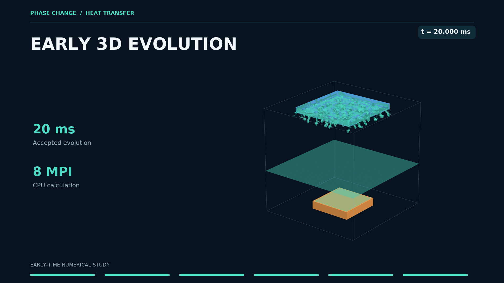

# CFD examples: IBM, heat transfer and phase change

Small, source-first examples built with [NGA2](https://github.com/desjardi/NGA2), prepared for sharing results and moving the work to another coding agent.

| Example | Purpose | Recorded scope |
|---|---|---|
| [01 IBM](examples/IBM_CFD-incomp_CPU-MPI_Fortran_01-marker-cylinder) | Incompressible marker forcing | 5-step MPI startup |
| [02 Shock + IBM](examples/IBM_CFD-comp_CPU-MPI_Fortran_02-shock-cylinder) | Compressible ghost-point IBM | 5-step MPI startup |
| [03 Water CHT](examples/FVFD_CFD-lowMach-CHT_CPU-MPI_Fortran_03-water-natural-convection-2D) | EOS buoyancy + solid conduction | Historical 10 s prototype |
| [04 Stefan](examples/FVFD-VOF-PLIC_CFD-incomp-phasechange_CPU-MPI_Fortran_04-stefan-2D) | Two-temperature phase-change reference | Single-grid analytic comparison |
| [05 Heated bubble](examples/FVFD-VOF-PLIC_CFD-incomp-CHT-phasechange_CPU-MPI_Fortran_05-heated-bubble-2D) | Heat-driven vapor growth / rise | Historical 2D demonstration |
| [06 Dielectric pool](examples/FVFD-VOF-PLIC_CFD-incomp-CHT-phasechange_CPU-MPI_Fortran_06-dielectric-pool-2D) | Cold ceiling + conservative phase inventory | User-stopped 2D development |
| [07 Immersion 3D](examples/FVFD-VOF-PLIC_CFD-incomp-CHT-phasechange_CPU-MPI_Fortran_07-immersion-3D) | True XYZ PLIC + conduction + flow | 20 ms completed; longer work in progress |

[Landscape video](media/IMMERSION_COOLING_LANDSCAPE_DRAFT01.mp4) · [Portrait video](media/IMMERSION_COOLING_PORTRAIT_DRAFT01.mp4) · [Example overview](media/EXAMPLE_OVERVIEW.mp4)

Start with [build/use instructions](docs/BUILD.md). Each directory has only the case source, short and demonstration inputs, and a small README. Upstream revision: `28a58d937af89dd506456048be1cad58f6d383a9`. No large result set or installed environment is included.

For a different agent: read [AGENTS.md](AGENTS.md), paste [START_HERE.md](prompts/START_HERE.md), then select a single case. For sharing: see [results and limitations](docs/RESULTS.md) and [video storyboard](media/STORYBOARD.md). Compact previews accompany the video draft.

The cold-start inputs and portable controller are new release preparation. Historical evidence does not imply every repackaged entry was rerun. Numerical execution, conservation checks, and predictive engineering validation are separate claims. All physics limitations remain explicit in [model notes](docs/MODELS_AND_LIMITS.md).

한국어: 실행은 `docs/BUILD.md`, 다른 에이전트 이식은 `prompts/START_HERE.md`부터 시작하세요. 현재 3D는 수치 실행 가능성을 보이는 초기 사례이며, 완성된 증발–응축 순환이나 실제 CPU 성능 검증으로 해석하면 안 됩니다.

Case folder convention: `METHOD_PHYSICS_RESOURCE_LANGUAGE_CASE`. `FVFD-VOF-PLIC` denotes the Cartesian finite-volume/difference flow path with geometric fluid-interface reconstruction. It is not LBM or a claim of solid IBM in every thermal example. All bundled historical runs used CPU MPI; none are labelled GPU.
