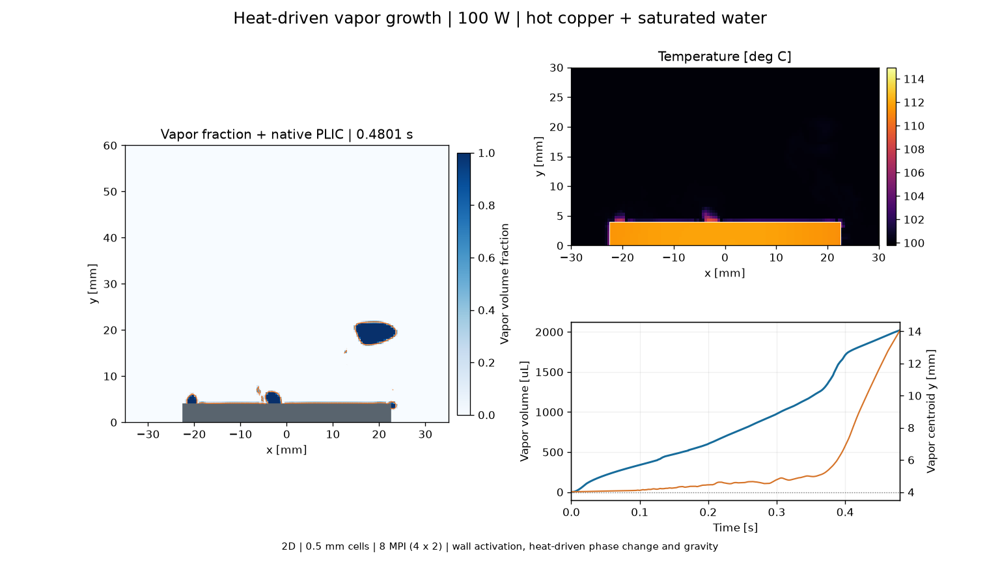

# Heat-driven seeded/wall-born vapor

Historical heat-driven bubble study. Local boundary fix; no predictive nucleation qualification.

```bash
python3 scripts/case.py build 05_heated_bubble_2d --jobs 8
python3 scripts/case.py run 05_heated_bubble_2d --input smoke
# Longer demonstration, explicitly selected:
python3 scripts/case.py run 05_heated_bubble_2d --input demo
```

MPI partition: `4 x 2 x 1` (8 ranks). `input.smoke` is deliberately short. A new machine's smoke output must be checked before longer runs. The publication wrapper/cold-start inputs are new portability work; historical results refer to the recorded original runs, not a fresh execution of these wrappers.

`src/` preserves source bytes from `cpu2d_open_boundary_momentum_quiet_20261116`. The input duration, output periods and checkpoint identity were adapted for a clean start. `provenance/source_manifest.json` binds copied source files. See [model limits](../../docs/MODELS_AND_LIMITS.md).

The demonstration input reproduces the recorded 100 W / 10 K-superheat, initially gas-free wall-birth conditions with 8 MPI ranks. Historical detachment was bracketed at 0.400–0.420 s and the tracked bubble rose about 8.56 mm by 0.480 s. This is prescribed wall-birth physics, not a calibrated microscopic nucleation law. The run was deliberately stopped after the visual goal, near 0.497 s; do not call the raw interrupted controller state a numerical divergence.


