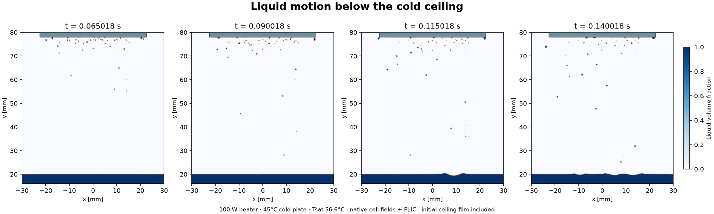

# Dielectric pool / cold ceiling

Accepted evolution reached 0.1611 s, then stopped by user. Velocity temporal accuracy remains unresolved.

```bash
python3 scripts/case.py build 06_dielectric_pool_2d --jobs 8
python3 scripts/case.py run 06_dielectric_pool_2d --input smoke
# Longer demonstration, explicitly selected:
python3 scripts/case.py run 06_dielectric_pool_2d --input demo
```

MPI partition: `4 x 2 x 1` (8 ranks). `input.smoke` is deliberately short. A new machine's smoke output must be checked before longer runs. The publication wrapper/cold-start inputs are new portability work; historical results refer to the recorded original runs, not a fresh execution of these wrappers.

`src/` preserves source bytes from `cpu2d_inventory_enthalpy_v2_20261117`. The input duration, output periods and checkpoint identity were adapted for a clean start. `provenance/source_manifest.json` binds copied source files. See [model limits](../../docs/MODELS_AND_LIMITS.md).


