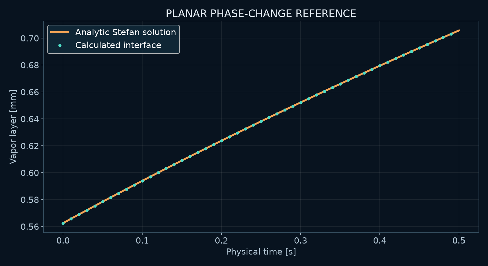

# Planar phase-change reference

One-grid analytic comparison completed to 0.5 s; not a general convergence proof.

```bash
python3 scripts/case.py build 04_stefan_2d --jobs 8
python3 scripts/case.py run 04_stefan_2d --input smoke
# Longer demonstration, explicitly selected:
python3 scripts/case.py run 04_stefan_2d --input demo
```

MPI partition: `1 x 1 x 1` (1 ranks). `input.smoke` is deliberately short. A new machine's smoke output must be checked before longer runs. The publication wrapper/cold-start inputs are new portability work; historical results refer to the recorded original runs, not a fresh execution of these wrappers.

`src/` preserves source bytes from `stefan_two_temperature_reference_20261113`. The input duration, output periods and checkpoint identity were adapted for a clean start. `provenance/source_manifest.json` binds copied source files. See [model limits](../../docs/MODELS_AND_LIMITS.md).


