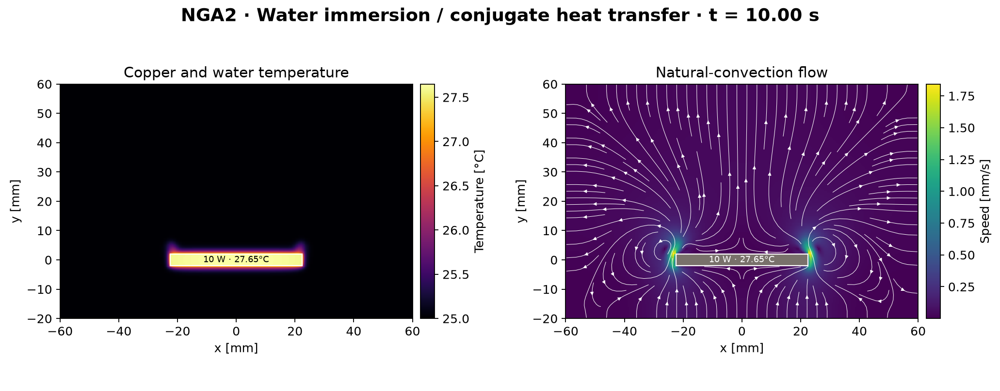

# EOS-driven natural convection and solid conduction

Historical 10 s prototype; open outer reservoir, not the later closed-side tank. No phase change.

```bash
python3 scripts/case.py build 03_water_cht_2d --jobs 8
python3 scripts/case.py run 03_water_cht_2d --input smoke
# Longer demonstration, explicitly selected:
python3 scripts/case.py run 03_water_cht_2d --input demo
```

MPI partition: `2 x 2 x 1` (4 ranks). `input.smoke` is deliberately short. A new machine's smoke output must be checked before longer runs. The publication wrapper/cold-start inputs are new portability work; historical results refer to the recorded original runs, not a fresh execution of these wrappers.

`src/` preserves source bytes from `cpu2d_water_eos_cht_20261113`. The input duration, output periods and checkpoint identity were adapted for a clean start. `provenance/source_manifest.json` binds copied source files. See [model limits](../../docs/MODELS_AND_LIMITS.md).


